# Observe, Imagine, Abstain

**Detecting hallucinated geometry in feed-forward 3D reconstruction.**

Feed-forward 3D models (VGGT, Pi3, Pi3X, MapAnything, Depth Anything 3) take a handful of unposed photographs and return dense geometry in one pass. Where no photograph shows a surface, they fill the gap from what they learned, and they report the invented surface with the same confidence as the observed one. This repository holds three things:

1. **HalluBench-3D**, a benchmark that hides a 3D region of a scene from every camera and measures how much of the invented geometry gets through the model's own confidence.
2. **A support head**, a small network on the frozen features of the backbone that says, per pixel, whether the output is corroborated by more than one view, and abstains in between. It trains on the backbone's own predictions, with no ground truth.
3. **Every result as a logged run**: CSVs, configs, run logs, checkpoints, and a dated log of every failure and correction.

<p align="center">
  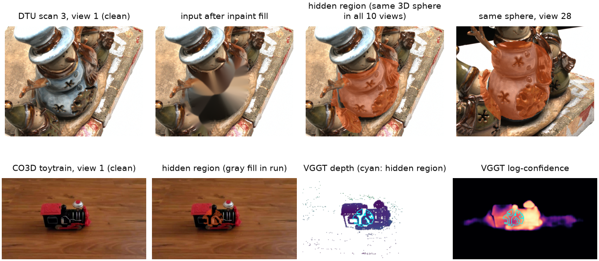
</p>

| | |
|---|---|
| Project page | https://prajak002.github.io/DTU-3D-reconstruction/ |
| Paper and supplement | [`docs/assets/paper.pdf`](docs/assets/paper.pdf), [`docs/assets/supp.pdf`](docs/assets/supp.pdf) (CVPR 2027 submission, anonymous) |
| Per-scene explorer | https://prajak002.github.io/DTU-3D-reconstruction/explorer.html |
| Downloads | [release `v1.0-cvpr2027-submission`](https://github.com/prajak002/DTU-3D-reconstruction/releases/tag/v1.0-cvpr2027-submission): PDFs, Overleaf project, every result CSV, the 56 head checkpoints, the overview video |
| Videos | `docs/assets/overview.mp4` (3.5 min), `paper/demo/demo.mp4` (protocol on real data, 3 min), `paper/demo/walkthrough.mp4` (end to end, 5 min) |

---

## Contents

- [The question](#the-question)
- [The benchmark](#the-benchmark)
- [Finding 1: native confidence leaks](#finding-1-native-confidence-leaks)
- [Finding 2: cheap fixes fail, and a head trained on the fill learns the fill](#finding-2-cheap-fixes-fail-and-a-head-trained-on-the-fill-learns-the-fill)
- [The detector: a label-free support head](#the-detector-a-label-free-support-head)
- [Results on four datasets the head never saw](#results-on-four-datasets-the-head-never-saw)
- [Which view saw it: the provenance head](#which-view-saw-it-the-provenance-head)
- [What abstaining buys downstream](#what-abstaining-buys-downstream)
- [The limit](#the-limit)
- [Repository layout](#repository-layout)
- [Reproduce](#reproduce)
- [How the work was run](#how-the-work-was-run)
- [Citation](#citation)

---

## The question

Suppose you are a conservator looking at a reconstruction of a dome and you see a crack. Before you send someone up a scaffold you want to know whether any photograph shows that crack, or whether the model drew it from what domes usually look like. Today you cannot tell: the confidence map is bright in both cases.

We define a predicted point as **hallucinated** when it lies on a surface that no input view observes, and we ask two questions:

- Does a model's native confidence separate observed from invented geometry?
- If not, can a detector be built on top of the model that does, without retraining the model and without ground truth?

## The benchmark

Labels for "no camera saw this" are normally impossible to get. The benchmark makes them for free by *creating* unobserved geometry in a controlled way.

<p align="center">
  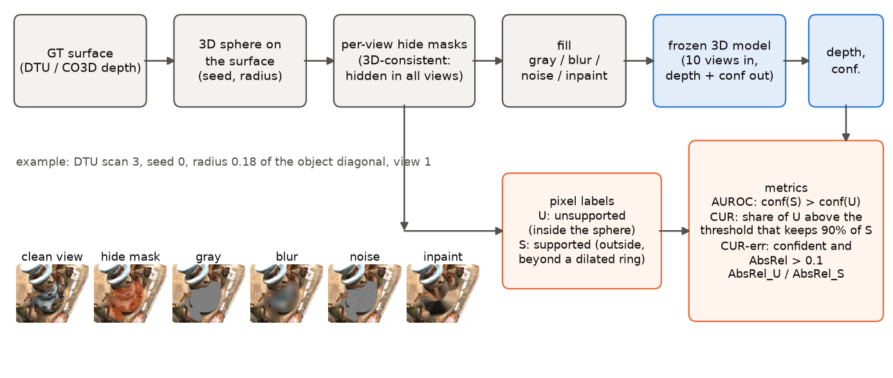
</p>

1. Place a sphere on the ground-truth surface of a scene (radius 0.10 or 0.18 of the object's diagonal, five random placements per scene).
2. Hide every pixel, in every input view, whose true 3D point lies inside the sphere. Because the hidden region is one 3D object, no camera sees it from any angle.
3. Fill the hole with gray, a blur of the original, noise, or an inpainting of the surround. The fill is an ablation: the result must not be an artefact of one kind of patch.
4. Run the frozen model on the filled views. Pixels inside the sphere are **unsupported (U)**, pixels well outside it are **supported (S)**, a thin ring in between is ignored.
5. Score the model's own confidence on U against S.

<p align="center">
  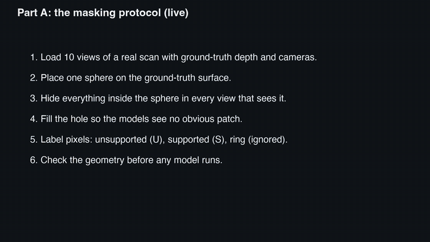
  <br><sub>The protocol running on DTU scan 3 and a CO3Dv2 hydrant (from <code>paper/demo/demo.mp4</code>). Cyan: the hidden region.</sub>
</p>

**Metrics**, computed per (model, scene, seed, radius, fill):

| metric | meaning |
|---|---|
| **AUROC** | probability that a supported pixel gets higher confidence than an unsupported one. 1.0 is perfect, 0.5 means confidence carries no information about support. |
| **CUR** (Confident-Unsupported Rate) | pick the threshold that keeps 90% of supported pixels; CUR is the share of unsupported pixels that also pass. This is the hallucination rate you experience after filtering by confidence. Lower is better. |
| **CUR-err** | share of unsupported pixels that pass the threshold *and* are wrong by more than 10% in depth. Confident and wrong. |
| **AbsRel_U, AbsRel_S** | depth error on unsupported and on supported pixels, after median scaling fitted on supported pixels. |
| controls | the same pixels under clean input, and the ratio of confidence inside the hidden region to its clean value. |

Before any model is scored, every scene passes two geometry guards: ground-truth depth reprojects consistently between views, and the unsupported points of one view land inside the hidden region of every other view. Statistics everywhere: 95% cluster-bootstrap intervals over scenes (10,000 resamples) and paired sign-flip permutation tests on per-scene means (20,000 permutations), Holm-corrected within each family of comparisons.

**Datasets.** DTU (18 benchmark scans on the lab rig, plus 22 extension scans), CO3Dv2 (18 phone orbits, two sequences from each of nine categories), ETH3D (nine building-scale DSLR scenes with laser-scanner ground truth) and nine Phototourism landmarks (Internet photographs of the British Museum, Florence cathedral, Lincoln Memorial, London Bridge, Milan cathedral, Mount Rushmore, Piazza San Marco, Sagrada Familia, St Paul's). No head was trained on any of these scenes; the heads train on the 79 DTU training scans only.

## Finding 1: native confidence leaks

CUR pooled over the blur and noise fills, five mask seeds, two radii. Share of invented geometry that survives a confidence filter keeping 90% of observed geometry. Lower is better.

| model | DTU (18 scans) | DTU (22 more scans) | CO3Dv2 (phone) | ETH3D (buildings) |
|---|---|---|---|---|
| VGGT-1B | **0.242** | 0.233 | 0.651 | 0.786 |
| Pi3 | 0.281 | 0.272 | **0.272** | **0.612** |
| Pi3X | 0.532 | 0.539 | 0.570 | 0.707 |
| MapAnything | 0.622 | 0.693 | 0.810 | 0.677 |
| Depth Anything 3 | 0.701 | 0.650 | 0.797 | 0.620 |

<p align="center">
  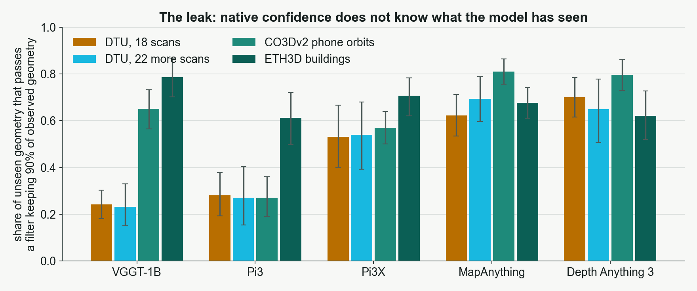
</p>

What this says:

- Every model lets between a quarter and four fifths of the geometry it invented through its own confidence filter.
- Only Pi3 behaves the same on the lab rig and on phone captures. VGGT, joint best on DTU, leaks 2.7 times more on CO3Dv2. The leak is largest on the dataset three of the models were trained on.
- The invented geometry is usually *accurate* (the depth error inside the hidden region is about the same as outside), so CUR-err stays near zero. The models imagine well. They do not say that they did.
- An inpainted fill, which leaves no seam, makes the leak worse, not better. Dropping from ten views to three changes nothing, and a distractor image changes nothing. The models are reading single-view appearance, not multi-view agreement.

<p align="center">
  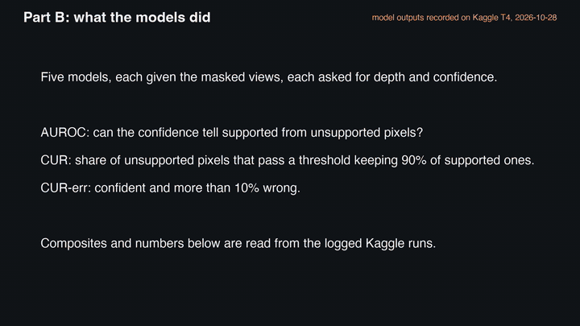
  <br><sub>Recorded outputs, left to right: masked input, ground-truth depth, the model's depth, the model's confidence. Cyan outline: the hidden region. Each panel shows the CSV row it came from.</sub>
</p>

## Finding 2: cheap fixes fail, and a head trained on the fill learns the fill

Two training-free alternatives, scored on the same rows:

- **Variance over perturbed inputs** (four photometrically perturbed forwards) is far worse than native confidence (AUROC 0.67 and 0.55 against 0.92 and 0.83 for VGGT and Pi3X) at four times the cost. The invented geometry is stable under perturbation.
- **Reprojection consistency** with the model's own cameras is at chance on the filled patches (AUROC 0.49, 0.48). The invented surface is coherent across views.

A head trained directly on the benchmark's filled patches scores AUROC 0.99 to 1.00 on them. So does a control head that sees one image at a time. Put to real single-view geometry, the fill-trained head scores *below* native confidence. It learned the fill, nothing else. We keep this result in the paper as a warning for anyone training on masking labels, and the per-image control became mandatory for every head that follows.

## The detector: a label-free support head

The fix was to change what the detector must learn, not the head. Same head, same loss, same training scenes; only the labels change.

<p align="center">
  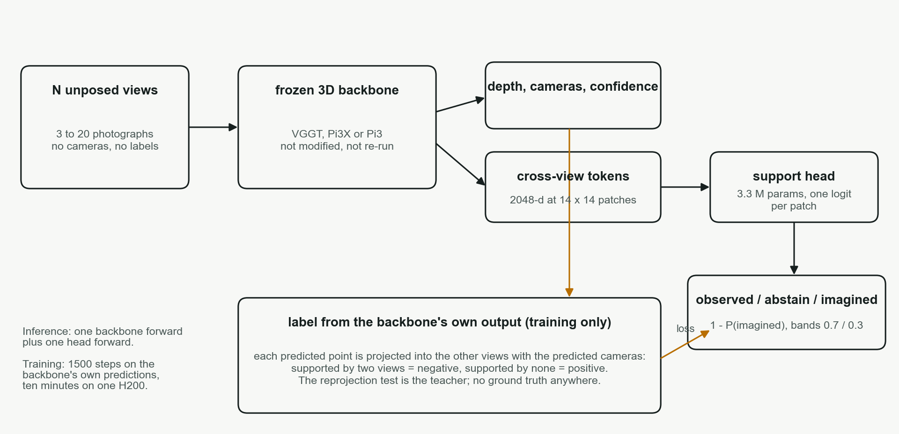
</p>

**Architecture.** A frozen backbone (VGGT-1B, Pi3X, Pi3 or Depth Anything 3) provides depth, cameras, native confidence and its multi-view tokens (for VGGT and DA3 the four cross-view layers the depth head reads, 2048-d at 14 x 14 patches; for Pi3X and Pi3 the decoder tokens that feed their confidence heads). The support head is LayerNorm and a 1 x 1 projection per layer to 256 channels, a sum, two 3 x 3 convolutions at patch resolution and one logit per patch, upsampled bilinearly: 1.7 to 3.3 M parameters, under 1% of the backbone's FLOPs, one forward. The backbone is neither modified nor re-run.

**Labels, with no ground truth.** Run the backbone once on clean views. Project every predicted point, with the predicted depth and cameras, into the other input views and count the views whose predicted surface it lands on. A pixel no other view supports is the positive class; a pixel two or more views support is the negative class. This is the reprojection test used as a teacher, so the head has to generalise beyond it to be worth having. Training: 1500 steps on the 79 DTU training scans, disjoint from every benchmark scene, 3 to 10 random clean views per step, ten minutes per backbone on one H200.

**Output.** The score is 1 minus P(imagined). Three bands, fixed in advance: **observed** above 0.7, **imagined** below 0.3, **abstain** in between. Every metric uses the continuous score.

**Controls.** The decisive one is the **per-image head**: the same head, same labels, on per-image encoder tokens before any cross-view attention. If it did as well, the signal would be an image cue (borders, depth edges) rather than multi-view support. Further controls: a linear probe on the same features and on each cross-view layer alone, the distance to the image border, the depth gradient, two extra initialisation seeds, a head trained on ground-truth visibility as the upper bound.

<p align="center">
  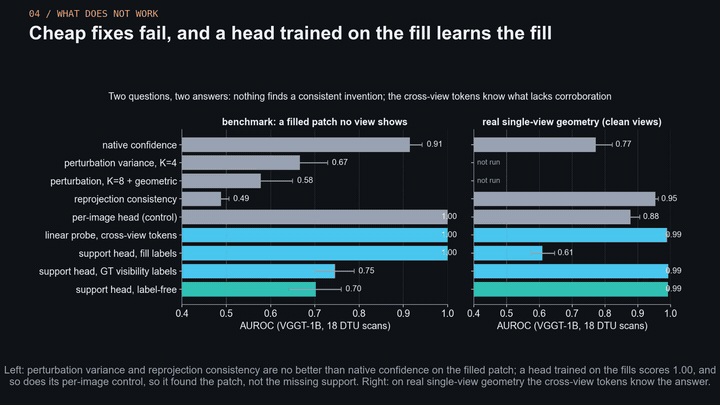
</p>

## Results on four datasets the head never saw

True-visibility protocol: clean views (3, 5 and 10 on DTU and ETH3D; 3 and 5 on CO3Dv2, where ten views around an object leave no single-view pixel), labels from ground truth, pooled over scenes and view counts. AUROC for separating single-view from supported geometry; CUR as above.

| | DTU | | CO3Dv2 | | ETH3D | | Phototourism | |
|---|---|---|---|---|---|---|---|---|
| **VGGT-1B** | AUROC | CUR | AUROC | CUR | AUROC | CUR | AUROC | CUR |
| native confidence | 0.772 | 0.530 | 0.754 | 0.723 | 0.715 | 0.566 | 0.802 | 0.451 |
| reprojection consistency | 0.954 | 0.082 | 0.793 | 0.693 | 0.975 | 0.069 | 0.824 | 0.340 |
| per-image control | 0.885 | 0.325 | 0.460 | 0.892 | 0.626 | 0.750 | 0.729 | 0.681 |
| head, ground-truth labels | 0.993 | 0.015 | 0.927 | 0.210 | 0.980 | 0.054 | 0.908 | 0.258 |
| **head, label-free** | **0.992** | **0.017** | **0.931** | **0.199** | **0.980** | **0.051** | **0.930** | **0.191** |
| **Pi3X** | | | | | | | | |
| native confidence | 0.820 | 0.493 | 0.697 | 0.846 | 0.887 | 0.304 | 0.839 | 0.450 |
| reprojection consistency | 0.914 | 0.164 | 0.885 | 0.224 | 0.977 | 0.054 | 0.814 | 0.360 |
| **head, label-free** | **0.988** | **0.025** | **0.939** | **0.190** | **0.963** | **0.103** | **0.940** | **0.167** |
| **Pi3** | | | | | | | | |
| native confidence | 0.841 | 0.489 | 0.551 | 0.882 | 0.814 | 0.498 | 0.847 | 0.447 |
| **head, label-free** | **0.990** | **0.021** | **0.930** | **0.225** | **0.951** | **0.139** | **0.931** | **0.181** |
| **Depth Anything 3** | | | | | | | | |
| native confidence | 0.836 | 0.430 | 0.683 | 0.743 | 0.643 | 0.635 | 0.782 | 0.512 |
| **head, label-free** | **0.982** | **0.040** | **0.879** | **0.323** | **0.974** | **0.070** | **0.925** | **0.202** |

<p align="center">
  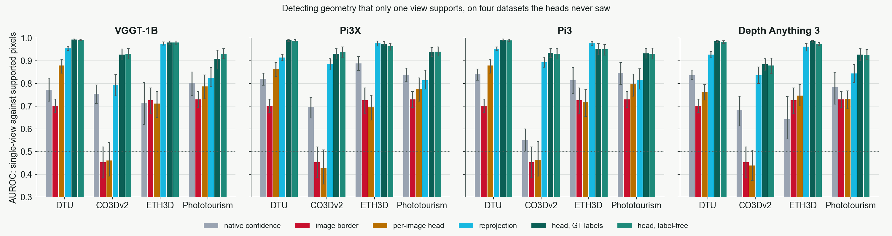
</p>

- The label-free head separates single-view from supported geometry at AUROC 0.93 to 0.99 against 0.55 to 0.89 for native confidence, and lets 2 to 32 times fewer unsupported pixels through.
- It matches the head trained on ground-truth visibility within 0.02 everywhere. A head that never sees ground truth is as good as one that does.
- The per-image control falls **below chance** on CO3Dv2 and ETH3D: a head that cannot see across views learns the frame edge, which marks single-view pixels on the lab rig and nowhere else.
- It beats reprojection consistency, its own teacher, on DTU, CO3Dv2 and the landmark photographs, and ties it on ETH3D, where adjacent DSLR views of a building make the reprojection test as good as any head.
- The landmark photographs are the capture this is meant for and the hardest for the alternatives: people stand between camera and monument, focal lengths differ from photo to photo, the model's cameras are least reliable. The head scores 0.93 to 0.94 there against 0.80 to 0.85 for native confidence.
- Where the signal lives: a linear probe on one VGGT layer at a time scores 0.87 at layer 4 (like the per-image control), 0.95 at layer 11, 0.99 at layers 17 and 23 on DTU; on CO3Dv2 the early layers collapse to 0.48 and 0.70 while the late layers hold 0.92 and 0.88. Support becomes linearly decodable in the second half of the cross-view aggregator.

<p align="center">
  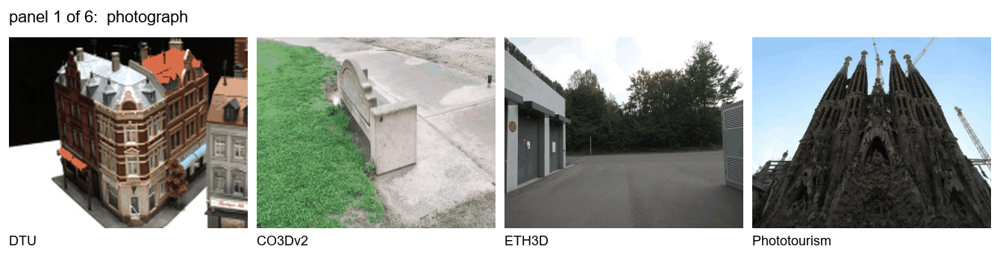
  <br><sub>One view per dataset, stepping through the six panels: photograph, ground-truth support (red: one view, green: two or more), native confidence, reprojection consistency, the per-image control, and the head's bands (green observed, yellow abstain, red imagined).</sub>
</p>

<p align="center">
  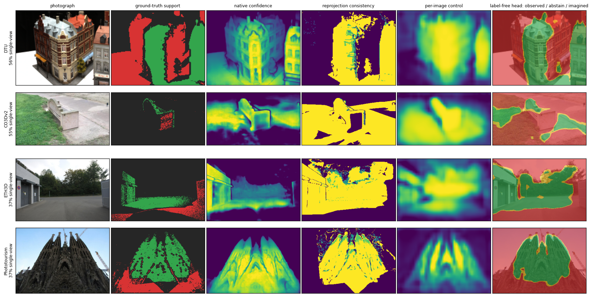
</p>

Pre-registered pass conditions (written with dates into `EXPERIMENTS.md` before the heads they judge were trained): Gate 3 (head trained on ground-truth visibility) and Gate 4 (label-free head) pass on every dataset and backbone.

## Which view saw it: the provenance head

The support head says *whether* a pixel is corroborated. The conservator also wants to know *by which photograph*. The provenance head reads the same frozen tokens and returns, for every pixel and every other input view, the probability that this view corroborates the surface there. Each target token queries the tokens of each other view with four-head attention, with no cameras and no positional code; a shared MLP over the attended evidence returns one logit per (target view, source view, patch). The support score is the probability that no view corroborates the pixel, so the head is scored on exactly the same cells as the other heads, and the per-view probabilities are its added output.

<p align="center">
  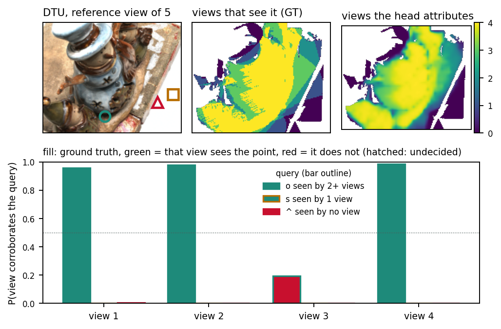
</p>

<p align="center">
  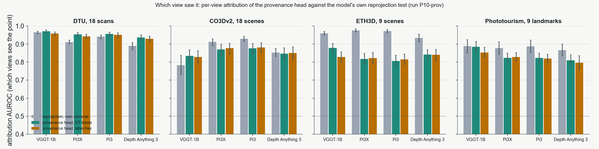
</p>

Measured against the reprojection test read per view (Gate 5, pre-registered before training):

- Its support score matches the convolutional head within 0.01 AUROC on 15 of 16 cells, so the structured output costs no detection.
- With no camera, the label-free head ranks the views that see a point above those that do not at attribution AUROC 0.93 to 0.96 on DTU, 0.83 to 0.88 on CO3Dv2, 0.82 to 0.84 on ETH3D and 0.80 to 0.85 on the landmarks; its top view sees the point for 98% of the supported pixels on DTU and 94% on CO3Dv2.
- It is ahead of reprojection attribution on DTU for three of four backbones, level on CO3Dv2, and behind on ETH3D and the landmarks, where the model's cameras and N-1 explicit projections per pixel know the frame geometry the tokens must infer. The gate's attribution clause therefore fails, the convolutional head stays the method of record, and the provenance head is reported for what it measures. The eight provenance heads are in the release as `heads_provenance.tar.gz`.

## What abstaining buys downstream

From the per-pixel scores (run P6-dump):

- With the bands fixed in advance, the head marks 57 to 87% of the pixels *observed*, of which 0.5 to 5% are single-view (per-image control: 50 to 94% with 4 to 20%).
- A threshold set on the *other* scenes of a dataset lets 1 to 2% of single-view pixels through on DTU and 7 to 20% elsewhere, against 57 to 83% for native confidence. VGGT's native confidence has no transferable scale at all.
- Fusing the views with the backbone's own cameras and keeping the 80% of points the head trusts most raises the accuracy of the fused DTU cloud from 0.65 to 0.77. Native confidence reaches 0.78 by a different route: it tracks depth error, the head tracks support. Multiplying the two gives 0.79 at a lower single-view rate; neither substitutes for the other.

## The limit

The head certifies agreement between views, not truth. Put back to the benchmark's own filled patches, which every view shows, the visibility heads score AUROC 0.70 to 0.75 on DTU, below native confidence on the same rows. Disagreement between two different backbones on the same views does not find the patch either (AUROC 0.52 to 0.61): five models of three families fill the hole with the same surface. A surface the model invents consistently in every view passes every cross-view test we have.

What does move it is the pixels it was drawn from. With the same hidden sphere filled three ways and the backbone run on each, the spread of the invented depth over the fills separates the patch from supported geometry at AUROC 0.82 to 0.98 on DTU, above native confidence; refilling one view only moves the surface in that view. A real capture offers no second fill, so this is a diagnosis rather than a detector, but it says where the invented surface comes from: the model reads the hole and draws what its pixels suggest.

## Repository layout

```
scripts/
  hallu3d.py              the benchmark: DTU loader, 3D-consistent masking, fills, metrics, statistics,
                          model wrappers (VGGT, Pi3, Pi3X, DA3, MapAnything), support matrix, provenance metrics
  co3d.py  eth3d.py  imc.py   loaders and preprocessing for CO3Dv2, ETH3D and the Phototourism landmarks
  oia_head.py             the support head (conv, linear probe, per-image control, provenance): training and wrappers
  run_h100.py             the GPU plan: every stage from training the heads to the dumps, stats and tables
  refill_eval.py  fuse_eval.py  analyze_dumps.py   fill sensitivity, fused point clouds, per-pixel analysis
  kaggle_driver*.py  kaggle_prelude.py  kaggle_p3_stages.py   single-file Kaggle kernels for the benchmark runs
  test_synthetic.py  test_oia.py  test_co3d.py     CPU tests (oracle / blind models, head plumbing, CO3D path)
  make_figures.py  make_fig_vis.py  make_fig_qual.py  make_fig_prov.py  make_fig_heritage.py  make_fig_threeway.py
  make_tab_vis.py  make_tab_leak.py  make_tab_prov.py          generated LaTeX tables
  make_assets.py  make_page.py  make_site.py  make_video.py  make_demo.py  make_walkthrough.py
                          numbers.json, charts, project page, explorer, results bundle, the three videos
  make_overleaf.py  make_supp_archive.py  merge_rows.py  compute_cost.py
  box/                    drivers for the GPU boxes (setup, the four H200 passes, the L4 relaunch)
results/                  one folder per run: CSV, config JSON, run log, kernel log, example composites
                          P1/P2: benchmark   P3: heads and baselines   P4: true-visibility protocol
                          P6/P7: adaptation, dumps, landmarks   P8: fused clouds, cross-model   P9: refill   P10: provenance
                          P3-stats.md, P10-prov-stats.md: every paired test
paper/
  tex/                    LaTeX sources (CVPR 2027 kit): main.tex, supp.tex, preamble.tex, generated tab_*.tex
  figures/                every figure, PDF and PNG, plus the per-dataset panels
  demo/                   demo.mp4 and walkthrough.mp4
docs/                     the project page (GitHub Pages): index.html, explorer.html, assets/ (numbers.json, charts, PDFs, videos)
EXPERIMENTS.md            run registry: every run id, the pre-registered gates with dates, their outcomes
LOG.md                    dated log of every run, failure, fix and correction
PLAN.md                   the project brief: idea, rules, phases, statistics protocol
```

## Reproduce

```
pip install -r requirements.txt     # CPU side (numpy, opencv, scipy, pandas, matplotlib, pillow)
                                    # model runs additionally need torch and the model repositories
```

**CPU-only checks, no model or data needed**

```
python scripts/test_synthetic.py    # oracle scores AUROC 1 / CUR 0, blind model 0.5 / 0.9; masks deterministic and disjoint
python scripts/test_oia.py          # the support and provenance heads end to end on a fake backbone
python scripts/test_co3d.py <co3d_prep> <out>
```

**The benchmark on real data (GPU)**

Runs were done on Kaggle T4s as single-file kernels:

```
cat scripts/kaggle_prelude.py scripts/hallu3d.py scripts/kaggle_driver.py > kernel/hallu3d_kaggle.py
# edit RUN_NAME / MODELS / CFG at the top of the driver section, then
kaggle kernels push -p kernel
kaggle kernels output <user>/<kernel> -p results/<run>
```

or locally on any 16 GB GPU:

```python
import hallu3d as H
root = H.find_dtu_root(["/path/to/dtu"])
H.run_benchmark(root, ["vggt", "pi3x"], cfg={"seeds": [0], "fills": ["blur"]}, out_csv="out.csv")
print(H.summarize("out.csv"))
```

Model names: `vggt`, `pi3`, `pi3x`, `da3`, `mapanything`, `mapanything_mv`, `<model>_pv<K>` (perturbation variance), `<model>_reproj` (reprojection consistency), `<model>_oiavisself` (label-free head), `<model>_oiavis` (ground-truth-visibility head), `<model>_oiavisselfpatch` (per-image control), `<model>_oiaprovself` (provenance head).

**Heads, protocols, statistics (GPU, one H200 or an L4)**

```
python scripts/run_h100.py all --dtu <DTU incl. training scans> --co3d <co3d_prep> --eth3d <eth3d_prep> --imc <imc_prep>
# stages can be run one at a time: trainvisself, vis, vis_co3d, vis_eth3d, vis_imc, adapt, dump, trainprov, prov, stats ...
```

The data: DTU from the public Kaggle dataset `tobyzhou/dtu-training` (MVSNet layout); CO3Dv2 preprocessed by `co3d.preprocess_co3d()` from the official single-sequence zips; ETH3D by `scripts/box/eth3d_prep.sh`; the landmarks by `scripts/imc.py` from the Kaggle redistribution of the IMC 2020 phototourism set. Pretrained heads are in the release; put them in `checkpoints/` (or point `OIA_CKPT_DIR` at them) and the training stages become no-ops.

**Paper, page, videos**

```
python scripts/make_tab_vis.py && python scripts/make_tab_leak.py && python scripts/make_tab_prov.py   # tables from results/
python scripts/make_figures.py --dtu <DTU> --co3d <co3d_prep>                                           # figures
python scripts/make_assets.py && python scripts/make_page.py && python scripts/make_site.py              # numbers, charts, page, explorer, bundle
python scripts/make_video.py                                                                            # overview video (ffmpeg)
cd paper/tex && tectonic main.tex && tectonic supp.tex                                                  # or pdflatex + bibtex
```

`make_site.py` refuses to write the page if a headline number on it differs from the CSVs.

## How the work was run

- **No fabricated numbers.** Every number in the paper, on the page and in this file maps to a CSV and a config in `results/`. While a run was pending its place in the paper was marked `pending`, never estimated.
- **Pre-registration.** Every pass condition for a detector was written into `EXPERIMENTS.md`, with a date and a commit, before the detector was trained. Five gates were set; the outcomes are recorded as written, including the one that passed only by the letter (and is not counted) and the one whose attribution clause failed.
- **Everything reported.** Failed runs, the fill-trained head that learned the fill, the one CO3Dv2 scene that narrowly missed a geometry guard, and every correction to a reported number are in `LOG.md`.
- **Controls on identical rows.** Native confidence, perturbation variance, reprojection consistency, two hand-crafted cues, a linear probe and a per-image head are scored on the same pixels as the proposed head, with paired tests.
- **Hyperparameters frozen early.** Fixed on the DTU training split before any benchmark scan was evaluated, then unchanged for CO3Dv2, ETH3D and the landmarks.

## Citation

Anonymous CVPR 2027 submission. If you use the benchmark or the heads before publication, please cite the repository.

```
@misc{hallubench3d2026,
  title  = {Observe, Imagine, Abstain: Detecting Hallucinated Geometry
            in Feed-Forward 3D Reconstruction},
  author = {Anonymous},
  year   = {2026},
  note   = {CVPR 2027 submission; code, results and checkpoints at this repository}
}
```
